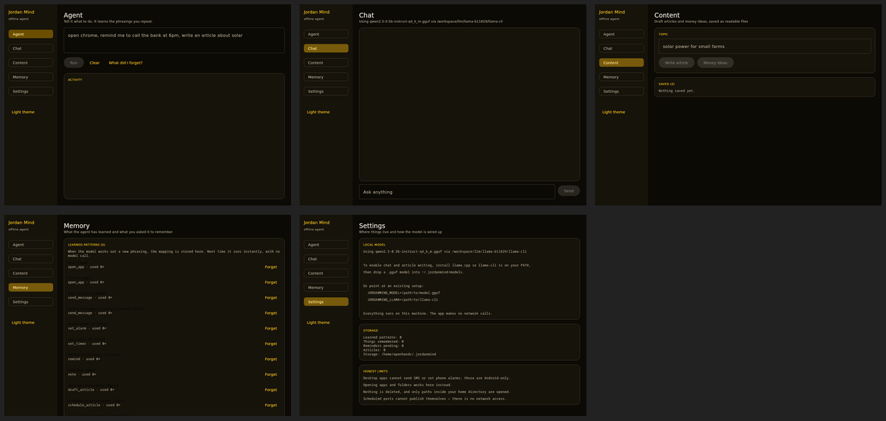
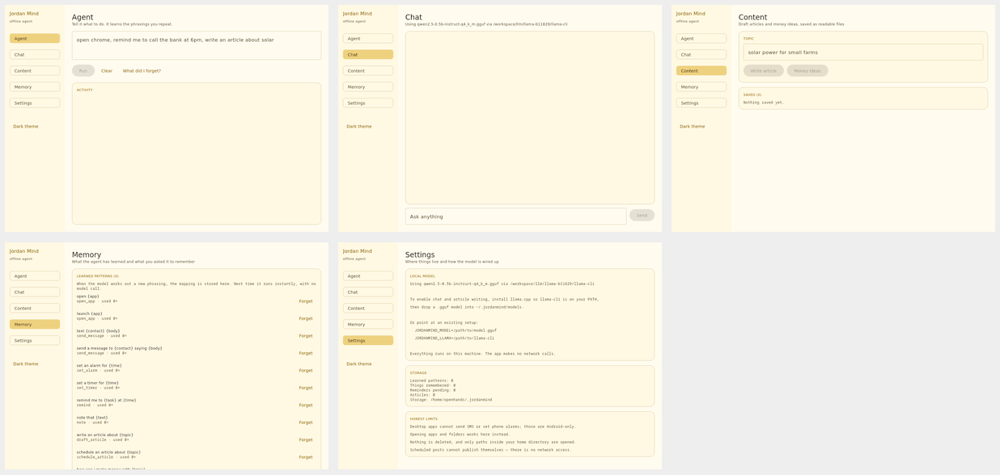
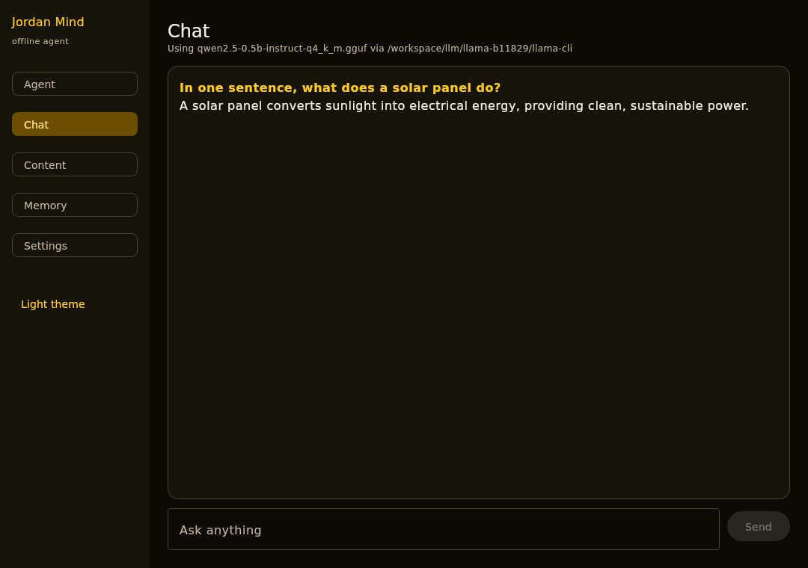
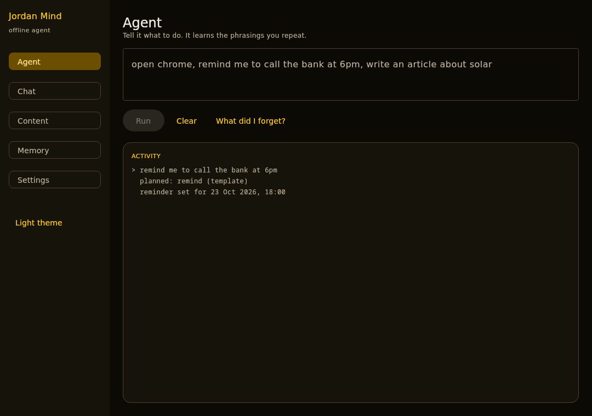
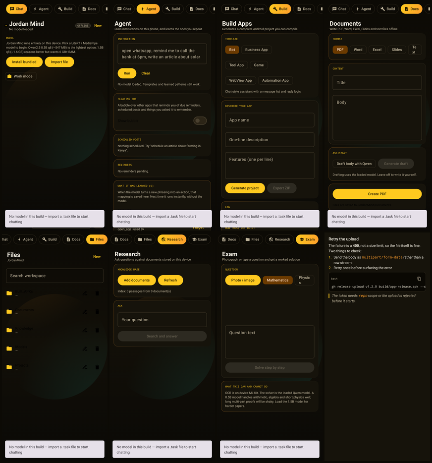

# Jordan Mind

An offline AI agent for Android and desktop. Everything — the language model, OCR, document
writing, search — runs on the device. The app declares no network permission, so it cannot reach
the internet even if it wanted to.

## What it does

| Tab | Capability |
|---|---|
| **Chat** | Streaming conversation with a local Qwen model. Dictation and spoken replies. |
| **Build** | Generates complete, compilable Android projects from six templates, exportable as a ZIP. |
| **Docs** | Writes PDF, Word (.docx), Excel (.xlsx), PowerPoint (.pptx) and text files. |
| **Files** | Browse, search, rename, delete, zip. All inside the app's own storage. |
| **Research** | Index your own documents and ask questions against them (local RAG). |
| **Exam** | Photograph a question, OCR it, get a step-by-step worked solution saved as PDF/Word. |
| **Agent** | Run instructions against the device — launch apps, compose messages, set alarms, schedule reminders — and see what it has learned. |

A desktop app shares the same agent core (`:core`), so planning, memory and slot filling behave
identically on both targets.

## Screenshots

Every image below is a real capture of the app running, not a mockup. The desktop shots come from
the Linux build under Xvfb; the phone shots are rendered by the Compose test suite on the JVM
(`ScreenshotTest`), because this machine has no KVM for an emulator.

### Desktop

Dark is the default; the light theme is one click away in the sidebar.





The model runs offline. This exchange was generated locally by `qwen2.5-0.5b-instruct-q4_k_m`:



The agent plans an instruction with a learned template, then executes it:



### Android



Android is dark-only by design. Full-size images are in `docs/screenshots/android/`.

## Install

CI builds the APK and the Linux and Windows desktop packages on every push; grab them from the
**Actions** tab. These are the names CI actually publishes:

| CI artifact | Contents | Notes |
|---|---|---|
| `JordanMind-android-apk` | `app-release.apk`, ~77 MB | No model bundled. Signed with the release keystore. |
| `JordanMind-windows` | `Jordan Mind-1.0.0.exe`, `.msi` | Desktop app, no model. Built by the `windows-latest` job. |
| `JordanMind-linux` | `.deb` and a runnable app image | Installs to `/opt/jordan-mind`. |

The Android app ships without a model so the download stays small. Install one from **Settings**:
pick a `.task` file on the device, or fetch one on a machine that has network access. Qwen2.5-0.5B
is ~521 MB and runs on 4 GB devices; 1.5B is ~1.6 GB and wants 6 GB+.

To get an offline-from-first-launch Windows installer, run the cross-build script from Linux:

```bash
packaging/windows/build-windows-installer.sh                 # ~100 MB, no model
BUNDLE_MODEL=1 packaging/windows/build-windows-installer.sh  # ~570 MB, model + llama.cpp runtime
```

`BUNDLE_MODEL=1` stages Qwen2.5-0.5B q4_k_m and the llama.cpp Windows build, so the installed app
answers offline with nothing else installed. It is not wired into CI because it downloads ~1 GB of
model weights per run.

Release builds are signed and minified with R8.

The APK is signed with a self-signed key, so Android will ask you to allow installation from
unknown sources before it will sideload.

Requires Android 10 (API 29) or newer. 4 GB RAM minimum; 6 GB+ recommended for the 1.5B model.

## Models

On Android, only LiteRT/MediaPipe `.task` bundles are supported, because that is what the
on-device inference engine loads. Two Qwen options exist in that format:

| Model | Size (q8) | Notes |
|---|---|---|
| Qwen2.5-0.5B-Instruct | ~521 MB | Fast, fits low-end phones. Good for short answers, arithmetic, summaries. |
| Qwen2.5-1.5B-Instruct | ~1.6 GB | Noticeably better reasoning and longer coherent answers. Needs 6 GB+ RAM. |

There is no 3B Qwen in the LiteRT lineup; 1.5B is the practical ceiling on Android.

The desktop app takes a different route: it drives `llama-cli` and loads GGUF files, which is why
the bundled installer ships `qwen2.5-0.5b-instruct-q4_k_m.gguf` rather than a `.task`. Any GGUF
`llama.cpp` supports can be dropped into `~/.jordanmind/models/` and used there. Android cannot do
this without shipping the native runtime for every ABI.

## Building

```bash
./gradlew assembleRelease                                     # APK, no bundled model
./gradlew assembleRelease -PbundleModel=/path/to/model.task   # model baked into assets/models/
./gradlew :desktop:createReleaseDistributable                 # desktop app
./gradlew :desktop:packageReleaseDeb                          # Linux .deb (needs fakeroot)
```

On Windows, `./gradlew :desktop:packageReleaseExe` produces the `.exe` and `.msi`. This cannot be
cross-compiled with `jpackage` from Linux, because it links a native launcher and runtime for the
target OS. `packaging/windows/build-windows-installer.sh` sidesteps that by assembling the image
by hand — see the script for the steps.

Requires JDK 21 and an Android SDK with platform 36 and build-tools 36.0.0. Point
`local.properties` at your SDK, or set `ANDROID_HOME`.

```bash
./gradlew testDebugUnitTest :core:test :desktop:test   # 68 tests
```

The packaged desktop app can verify itself without a display:

```bash
"desktop/build/compose/binaries/main-release/app/Jordan Mind/bin/Jordan Mind" --selftest
```

It exercises planning, learning, memory, article export, persistence across a restart, and the
path-traversal guards.

## Privacy

There is no networking code in this project. The Android manifest removes `INTERNET` and
`ACCESS_NETWORK_STATE` outright, verifiable on any build:

```bash
aapt2 dump badging app-release.apk | grep -i internet   # prints nothing
```

Conversations, reminders, facts and drafts are stored on the device only.

## Honest limitations

- **APK compilation happens off-device.** Tab 2 writes real Gradle projects and they are verified
  to build, but the phone does not run AGP/AAPT2 itself — that toolchain does not fit alongside
  the model. Open the exported folder in Android Studio, or run `./gradlew assembleDebug`.
- **The 0.5B model is small.** It handles everyday questions well and will stumble on genuinely
  hard multi-step reasoning. Load 1.5B when quality matters more than speed.
- **Dictation may need the network.** Speech recognition uses the system recogniser; with no
  INTERNET permission it fails on devices whose recogniser is cloud-backed. Typing always works.
  Fully offline dictation would need bundled Vosk weights (~50 MB), deliberately left out.
- **Retrieval is lexical, not neural.** The RAG embedder is a hashed bag-of-words with cosine
  similarity — fast and dependency-free, but it matches wording, not meaning.
- **"Learning" means remembering instruction-to-action mappings**, not training the model. No
  weights are ever modified; the model is fixed and read-only.
- **Desktop actions are sandboxed** to the user's home directory, and links are restricted to
  `http(s)`.
- **Gemma 3 1B cannot be bundled.** It is gated behind a signed licence and returns HTTP 401 to
  unattended downloads.
